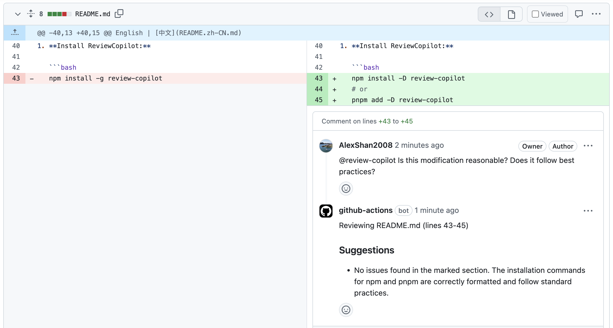
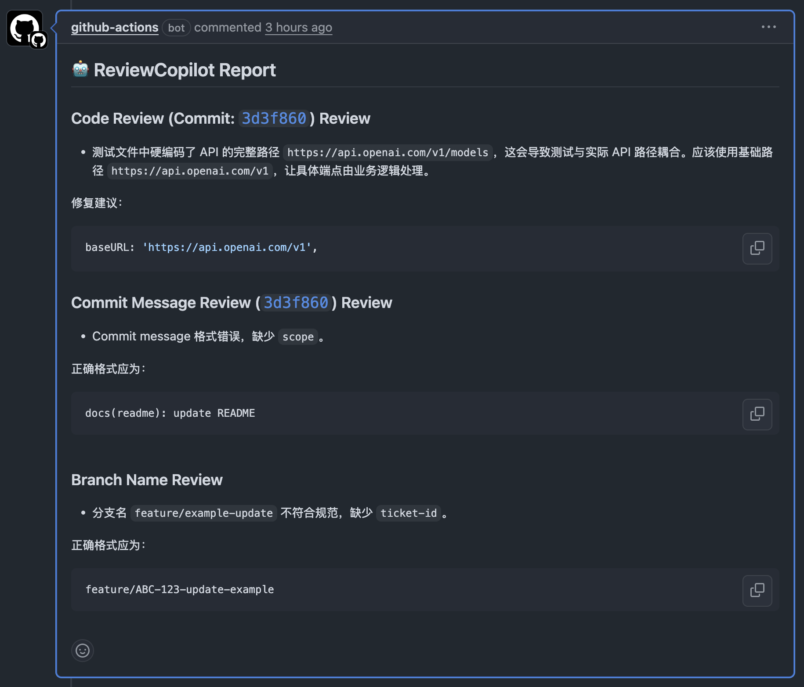

English | [中文](README.zh-CN.md)

<p align="center">
  
</p>

<h1 align="center">ReviewCopilot</h1>

<p align="center">
  <strong>AI-powered code review assistant for GitHub with customizable rules and multi-provider support</strong>
</p>

> **⚠️ Beta**: ReviewCopilot is under active development. APIs, configuration format, and provider behavior may change between minor versions. Please pin a specific version in production and report issues you run into.

<p align="center">
  <a href="https://github.com/AlexShan2008/review-copilot/actions"></a>
  
  <a href="https://codecov.io/gh/AlexShan2008/review-copilot"></a>
  <a href="https://www.npmjs.com/package/review-copilot"></a>
  <a href="https://www.npmjs.com/package/review-copilot"></a>
  <a href="https://opensource.org/license/MIT"></a>
  <a href="https://github.com/AlexShan2008/review-copilot/blob/main/CONTRIBUTING.md"></a>
</p>

---

## 📋 Table of Contents

- [✨ Features](#-features)
- [🚀 Quick Start](#-quick-start)
- [📦 Installation](#-installation)
- [⚙️ Configuration](#️-configuration)
- [🤖 AI Providers](#-ai-providers)
- [🔧 Usage](#-usage)
- [🏗️ CI/CD Integration](#️-cicd-integration)
- [📚 Examples](#-examples)
- [🖼️ Screenshots](#️-screenshots)
- [🐛 Troubleshooting](#-troubleshooting)
- [🤝 Contributing](#-contributing)
- [📄 License](#-license)

---

## ✨ Features

<table>
<tr>
<td width="50%">

**🤖 AI-Powered Reviews**
- OpenAI GPT models support
- DeepSeek integration
- Customizable review prompts
- Multi-provider support

</td>
<td width="50%">

**📝 Smart Rules**
- Commit message validation
- Branch naming conventions
- Custom review points
- File pattern filtering

</td>
</tr>
<tr>
<td width="50%">

**🔧 Easy Integration**
- GitHub Actions ready
- GitLab CI (beta support)
- Environment-based config
- Zero-config setup

</td>
<td width="50%">

**🎯 Flexible & Secure**
- YAML configuration
- Environment variables
- Glob pattern filtering
- Secure API key management

</td>
</tr>
</table>

---

## 🚀 Quick Start

Get ReviewCopilot running in under 2 minutes:

```bash
# 1. Install
npm install -D review-copilot

# 2. Initialize
npx review-copilot init

# 3. Set your API key
echo "AI_API_KEY_DEEPSEEK=your-api-key" >> .env

# 4. Run review
npx review-copilot review
```

> **💡 Tip**: DeepSeek is recommended for stability. OpenAI support is in beta.

### 🎯 What you get:
- ✅ Automated code quality analysis
- ✅ Security vulnerability detection  
- ✅ Performance optimization suggestions
- ✅ Best practices enforcement
- ✅ Direct PR comments integration

### 💭 Why ReviewCopilot?

<table>
<tr>
<td width="50%">

**⏰ Save Time**
- Instant feedback on code changes
- Reduce manual review time by 60%
- Focus on architecture, not syntax

</td>
<td width="50%">

**🔧 Easy Setup**
- Zero configuration required
- Works with existing CI/CD
- Supports multiple AI providers

</td>
</tr>
<tr>
<td width="50%">

**📈 Improve Quality**
- Consistent review standards
- Catch issues early
- Learn from AI suggestions

</td>
<td width="50%">

**💰 Cost Effective**
- Reduce senior developer review time
- DeepSeek: ~$0.001 per request
- OpenAI: ~$0.01 per request

</td>
</tr>
</table>

---

## 📦 Installation

### Using npm
```bash
npm install -D review-copilot
```

### Using pnpm
```bash
pnpm add -D review-copilot
```

### Using yarn
```bash
yarn add -D review-copilot
```

---

## ⚙️ Configuration

### Basic Setup

After running `npx review-copilot init`, you'll get a `.review-copilot.yaml` file:

```yaml
providers:
  deepseek:
    enabled: true
    apiKey: ${AI_API_KEY_DEEPSEEK}
    model: deepseek-chat

rules:
  commitMessage:
    enabled: true
    pattern: '^(feat|fix|docs|style|refactor|test|chore|ci)(\\(.+\\))?: .{1,50}'
  
  branchName:
    enabled: true
    pattern: '^(feature|bugfix|hotfix|release)/[A-Z]+-[0-9]+-.+'
  
  codeChanges:
    enabled: true
    filePatterns:
      - '**/*.{ts,tsx,js,jsx}'
      - '!**/dist/**'
      - '!**/node_modules/**'
```

### Environment Variables

Create a `.env` file in your project root:

```env
# Choose your AI provider
AI_API_KEY_DEEPSEEK=your-deepseek-api-key
AI_API_KEY_OPENAI=your-openai-api-key
```

### Advanced Configuration

<details>
<summary>📖 Click to expand advanced configuration options</summary>

```yaml
providers:
  openai:
    enabled: false
    apiKey: ${AI_API_KEY_OPENAI}
    model: gpt-4o-mini
    baseURL: https://api.openai.com/v1
  
  deepseek:
    enabled: true
    apiKey: ${AI_API_KEY_DEEPSEEK}
    model: deepseek-chat
    baseURL: https://api.deepseek.com/v1

customReviewPoints:
  - name: 'Security Check'
    prompt: 'Review code for potential security vulnerabilities, focusing on input validation, authentication, and data handling.'
  
  - name: 'Performance Review'
    prompt: 'Analyze code for performance bottlenecks, memory usage, and optimization opportunities.'
  
  - name: 'Accessibility Check'
    prompt: 'Review frontend code for accessibility compliance and best practices.'

rules:
  commitMessage:
    enabled: true
    pattern: '^(feat|fix|docs|style|refactor|test|chore|ci)(\\(.+\\))?: .{1,50}'
    prompt: 'Ensure commit messages follow Conventional Commits specification.'
  
  branchName:
    enabled: true
    pattern: '^(feature|bugfix|hotfix|release)/[A-Z]+-[0-9]+-.+'
    prompt: 'Check if branch name follows the pattern: <type>/<ticket-id>-<description>'
  
  codeChanges:
    enabled: true
    filePatterns:
      - '**/*.{ts,tsx,js,jsx,py,java,go,rs}'
      - '!**/test/**'
      - '!**/tests/**' 
      - '!**/*.test.*'
      - '!**/*.spec.*'
      - '!**/dist/**'
      - '!**/build/**'
      - '!**/node_modules/**'
      - '!**/coverage/**'
    prompt: 'Review code changes focusing on code quality, potential bugs, performance, security, and best practices.'
```

</details>

---

## 🤖 AI Providers

### DeepSeek (Recommended)
- ✅ Stable and reliable
- ✅ Cost-effective
- ✅ Good code understanding
- 🔑 Get your API key: [DeepSeek Platform](https://platform.deepseek.com/)

### OpenAI (Beta)
- ⚠️ Beta support
- ✅ High-quality reviews
- ⚠️ Higher cost
- 🔑 Get your API key: [OpenAI Platform](https://platform.openai.com/)

---

## 🔧 Usage

### Command Line

```bash
# Review current branch changes
npx review-copilot review

# Review specific pull request
npx review-copilot review --pr 123

# Initialize configuration
npx review-copilot init

# Show help
npx review-copilot --help
```

### File Filtering

Control which files are reviewed using glob patterns:

```yaml
filePatterns:
  # Include patterns
  - '**/*.{ts,tsx,js,jsx}'
  - '**/*.{py,java,go,rs}'
  
  # Exclude patterns
  - '!**/node_modules/**'
  - '!**/dist/**'
  - '!**/build/**'
  - '!**/*.test.*'
  - '!**/*.spec.*'
```

---

## 🏗️ CI/CD Integration

### GitHub Actions

Create `.github/workflows/review.yml`:

```yaml
name: Code Review

on:
  pull_request:
    types: [opened, synchronize]
  issue_comment:
    types: [created]

jobs:
  review:
    runs-on: ubuntu-latest
    if: github.event_name == 'pull_request' || contains(github.event.comment.body, '@review-copilot')
    
    steps:
      - uses: actions/checkout@v4
        with:
          fetch-depth: 0
      
      - uses: actions/setup-node@v4
        with:
          node-version: '18'
      
      - run: npm install -g review-copilot
      
      - name: Run Review
        env:
          AI_API_KEY_DEEPSEEK: ${{ secrets.AI_API_KEY_DEEPSEEK }}
          GITHUB_TOKEN: ${{ secrets.GITHUB_TOKEN }}
        run: review-copilot review
```

### Repository Secrets

Add your API key to GitHub repository secrets:
1. Go to **Settings** → **Secrets and variables** → **Actions**
2. Click **New repository secret**
3. Name: `AI_API_KEY_DEEPSEEK`
4. Value: Your DeepSeek API key

> **🔒 Security Note**: Never commit API keys directly to your repository. Always use GitHub Secrets or environment variables.

---

## 📚 Examples

### Manual Review Trigger

Comment `@review-copilot` on any pull request to trigger a manual review:



### Automated PR Reviews

ReviewCopilot automatically reviews code changes and posts detailed feedback:



For complete setup instructions, see our [examples directory](examples/README.md).

---

## 🖼️ Screenshots

<details>
<summary>📸 Click to view more screenshots</summary>

### Review Comment Example


### Manual Trigger Example  


### Live Example
See a real review comment: [ReviewCopilot PR Review Example](https://github.com/AlexShan2008/review-copilot/pull/25#issuecomment-2922197158)

</details>

---

## 🐛 Troubleshooting

<details>
<summary>🔧 Common Issues and Solutions</summary>

### API Key Issues
```bash
# Error: No API key found
# Solution: Check your .env file
echo "AI_API_KEY_DEEPSEEK=your-key" >> .env
```

### GitHub Actions Permissions
```yaml
# Add to your workflow if needed
permissions:
  contents: read
  pull-requests: write
  issues: write
```

### File Pattern Issues
```yaml
# Make sure to escape special characters
filePatterns:
  - '**/*.{ts,tsx}' # ✅ Correct
  - '**/*.{ts,tsx}' # ❌ May cause issues without quotes
```

### Common Error Messages

| Error | Solution |
|-------|----------|
| `No changes detected` | Ensure you're in a git repository with changes |
| `API key not found` | Check your `.env` file and environment variables |
| `Rate limit exceeded` | Wait a moment and try again, or upgrade your API plan |
| `File pattern error` | Verify your glob patterns in configuration |

</details>

---

## 🤝 Contributing

We welcome contributions! Here's how you can help:

### Development Setup
```bash
# Clone the repository
git clone https://github.com/AlexShan2008/review-copilot.git
cd review-copilot

# Install dependencies
pnpm install

# Run tests
pnpm test

# Build the project
pnpm build
```

### Ways to Contribute
- 🐛 **Report bugs** by opening an issue
- ✨ **Suggest features** or improvements
- 📖 **Improve documentation**
- 🔧 **Submit pull requests**
- 🧪 **Add test cases**

Please read our [Contributing Guide](CONTRIBUTING.md) for detailed guidelines.

---

## 📊 Project Status

> **Current Status**: ReviewCopilot is in **Beta**. Core review flows are working and covered by tests, but breaking changes may still land before a stable 1.0 release.
> - ✅ **GitHub integration**: Fully supported
> - ⚠️ **GitLab integration**: Beta (PRs welcome!)
> - ✅ **DeepSeek provider**: Stable
> - ⚠️ **OpenAI provider**: Beta (PRs welcome!)

## 🌟 Community & Support

<div align="center">

[](https://github.com/AlexShan2008/review-copilot/stargazers)
[](https://github.com/AlexShan2008/review-copilot/network/members)
[](https://github.com/AlexShan2008/review-copilot/issues)

</div>

### 📞 Get Help
- 📋 **Documentation**: Check our [examples](examples/README.md)
- 🐛 **Bug Reports**: [Open an issue](https://github.com/AlexShan2008/review-copilot/issues/new?template=bug_report.md)
- 💡 **Feature Requests**: [Request a feature](https://github.com/AlexShan2008/review-copilot/issues/new?template=feature_request.md)
- 💬 **Questions**: [Ask in Issues](https://github.com/AlexShan2008/review-copilot/issues)

---

## 📄 License

This project is licensed under the MIT License - see the [LICENSE](LICENSE) file for details.

---

<p align="center">
  <strong>Made with ❤️ by the ReviewCopilot team</strong>
</p>

<p align="center">
  <a href="https://github.com/AlexShan2008/review-copilot/issues">Report Bug</a> •
  <a href="https://github.com/AlexShan2008/review-copilot/issues">Request Feature</a> •
  <a href="https://github.com/AlexShan2008/review-copilot">⭐ Star Us</a>
</p>
